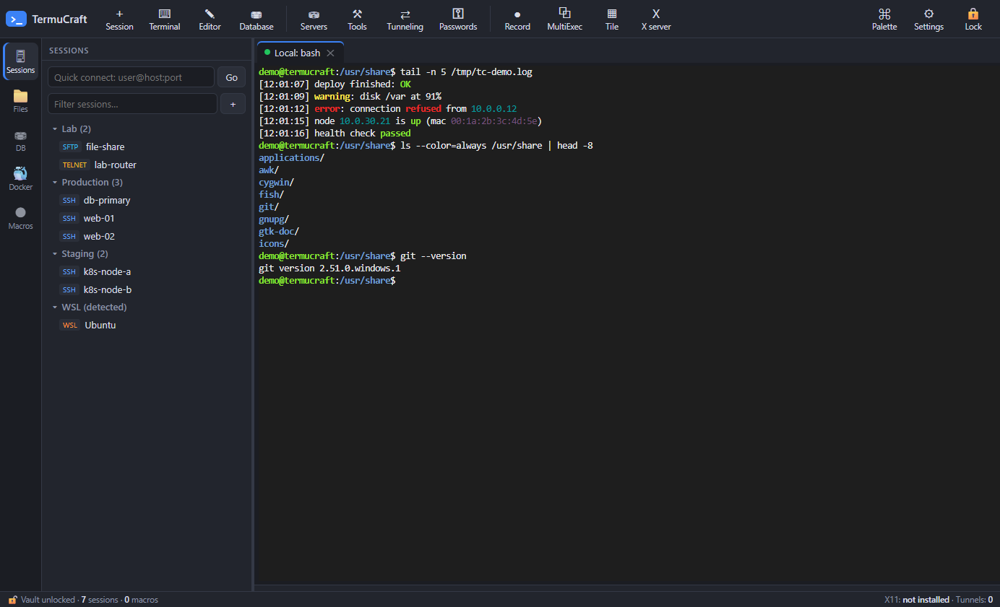
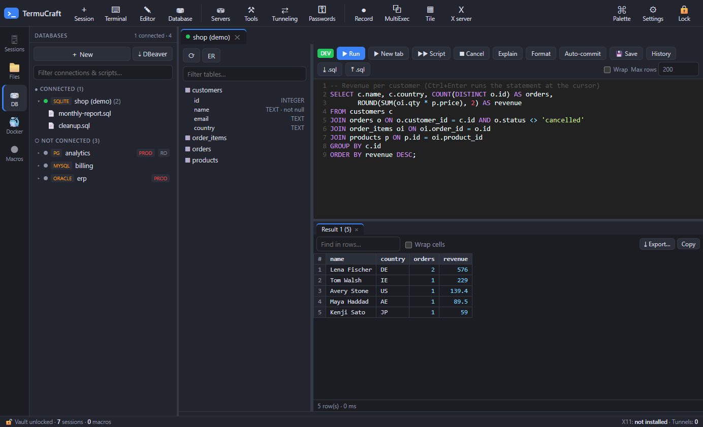
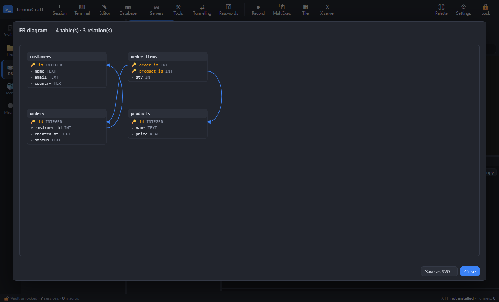

# TermuCraft

**One open-source Windows workstation for remote work: terminals, files and databases in a single app.**

TermuCraft combines an SSH/SFTP/serial/WSL terminal suite (in the spirit of MobaXterm) with a full database workbench
(in the spirit of DBeaver). Every password lives in one encrypted vault. It runs on your own PC only. There is no
account, no cloud and no telemetry, and it never connects to the internet by itself: the only network traffic is the
connections you open to your own servers and databases.

> TermuCraft is an independent project. It is not affiliated with or endorsed by Mobatek (MobaXterm) or DBeaver
> Corp. Those names are used only to describe what TermuCraft can import from.

**Free and open source (MIT).** Anyone can use it, change it and share it. Found a bug or have an idea?
[Open an issue](https://github.com/bmmbaaddt/termucraft/issues). Pull requests are welcome.

### Screenshots

**Terminals and sessions:** a local bash session with highlighted output (OK, warning, error, IPs, MACs) and sessions in folders.



**Database workbench:** connections with their scripts, schema tree with columns, SQL editor and result grid.



**ER diagram** drawn from the database's foreign keys:



---

## Contents
- [Features](#features)
- [Install](#install)
- [Getting started](#getting-started)
- [Moving from MobaXterm or DBeaver](#moving-from-mobaxterm-or-dbeaver)
- [Keyboard shortcuts](#keyboard-shortcuts)
- [Security model](#security-model)
- [Build from source](#build-from-source)
- [Testing](#testing)
- [Project layout](#project-layout)
- [Contributing](#contributing)
- [Builds and privacy](#builds-and-privacy)
- [Credits and license](#credits-and-license)

---

## Features

### Terminals and sessions
- **Session types:** SSH, SFTP, Telnet, Serial (COM ports), local shells, WSL, RDP (through Windows `mstsc`), VNC (through an external viewer) and Browser bookmarks.
- **Linux-style local terminal:** the Terminal button opens bash, like MobaXterm's local terminal. It uses Git Bash if installed, otherwise WSL, otherwise PowerShell. You can pick any shell in Settings.
- **Fast, smooth rendering:** GPU-accelerated drawing (WebGL), so full-screen programs such as `htop`, `vim` or AI CLIs redraw smoothly.
- **SSH sign-in:** password, key file, SSH agent, keyboard-interactive, jump host (gateway), X11 forwarding, start folder and startup command.
- **SSH keys:**
  - Use OpenSSH or PuTTY (.ppk v2) private keys, with or without a passphrase.
  - **Keep a key inside the encrypted vault**, so it keeps working if the file moves and travels with vault backups.
  - **Install public key on server** (right-click a session), like `ssh-copy-id`: log in once with your password, and from then on the key is used.
  - The **key generator** (Ed25519/RSA/ECDSA) can save the new key as a credential, attach it to a session, or install it on a server in one step.
- **Host keys:** trust on first use, with a warning if a host's key changes.
- **Organizing sessions:** folders, filter, quick connect (`user@host:port`), duplicate, recent list, and a right-click menu on everything.
- **Split view:** show any two tabs side by side.
- **Tile view:** show every terminal in a grid.
- **MultiExec:** type into every checked terminal at once.
- **Monitoring bar** for Linux hosts: CPU, RAM, disk, load, uptime, users, network rate and response time.
- **Syntax highlighting** of terminal output: errors, warnings, OK words, IPs and MACs, plus your own regex rules. It never touches full-screen apps or text the host already colored.
- **Macros:** record them or write them by hand. Supports special keys (`{TAB}`, `{ESC}`, `{^C}`, `{WAIT:ms}`) and Ctrl+Alt+1…9 hotkeys.
- **Session logging:** log one tab, or every session automatically. ANSI escape codes are stripped from the logs.

### Files
- **SFTP browser:** a sidebar for any SSH tab, or a session of its own.
  - Upload and download, including whole folders and drag-and-drop.
  - Rename, chmod, new folder or file, recursive delete, edit remote files, and "cd terminal here".
- **Local and WSL files:** local terminal tabs browse the Windows filesystem; WSL tabs browse `\\wsl.localhost\<distro>`.
- **Path box:** accepts absolute paths, relative paths, `..`, `~`, `~/dir` and quoted paths.
- **Built-in text editor** (CodeMirror): syntax modes, find/replace, Ctrl+S, and editing of local or remote files.

### Database workbench
Supports **PostgreSQL, MySQL/MariaDB, Oracle, SQL Server and SQLite** out of the box. Oracle runs in thin mode, so no Oracle client is needed. A connection can go directly to the server or **through any saved SSH session**.

**Any other database through ODBC**, such as IBM Db2, Snowflake, ClickHouse, Teradata, Informix, SAP HANA, Firebird, Vertica, MS Access, Excel and CSV folders:
- Install the vendor's 64-bit ODBC driver yourself. TermuCraft **never downloads drivers**.
- Add the database once under **⚙ Database types…** in the connection dialog (like DBeaver's Driver Manager). Pick the installed driver; known drivers fill in the connection-string template for you.
- Or choose **Other (ODBC)** and type a connection string directly.
- ODBC connections get the schema tree, SQL editor, streaming result grid, export, filters, transactions, keys and foreign-key navigation (when the driver reports keys), and grid editing for tables with a primary key.

- **Navigator tree:** per schema, folders for tables, views, materialized views, functions, procedures, packages, sequences and triggers (view their source). Everything starts collapsed, and the folders you open stay open. Includes a database switcher.
- **Open declaration:** F4 or Ctrl+click a table, view or routine name in the SQL editor to find it in the tree and open its properties or source.
- **Scripts:** saved per connection (DBeaver-style), with Ctrl+S to save and searchable query history.
- **SQL editor:**
  - Autocomplete that pops up as you type: tables, `alias.`/`table.` columns, bare column names of the tables in the query, and keywords.
  - Ctrl+Enter runs the statement at the cursor; Alt+X runs the whole script.
  - **Run into a new result tab** with Ctrl+\\. **Pin** results so the next run keeps them.
  - **Explain plan** (Ctrl+Shift+E) and **Format SQL** (Ctrl+Shift+F).
  - **Script variables:** `${name}` is asked for before running.
  - Understands `BEGIN … END` bodies, MySQL `DELIMITER` and Oracle `/` terminators.
- **Result grid:**
  - **Selection like DBeaver:** click, Shift+click, Ctrl+click or drag over cells; click or drag row numbers for whole rows and headers for whole columns; `#` or Ctrl+A selects everything. Arrow keys, Tab, Home/End and PgUp/PgDn move (Shift extends). The status bar shows the selection size, plus its sum and average when the values are numbers.
  - **Copy:** Ctrl+C copies the selection (tab-separated, pastes cleanly into Excel), Ctrl+Shift+C adds column names, and *Copy as…* gives CSV, JSON, Markdown, SQL, HTML, XML or TXT.
  - Smooth with very large results: only the visible rows are drawn. Columns can be resized by dragging the header edge.
  - Binary values that hold text are shown as text; other bytes are shown as `0x…` hex.
  - Sort, find, a cell viewer, and multiple result sets.
  - **Server-side `WHERE` / `ORDER BY` filter** on table data.
  - **Big results are streamed:** only the rows you see are downloaded, **Fetch more** gets the next batch, and **Fetch all** gets every row.
- **Editing data in the grid** (needs a primary key):
  - Edit cells inline (date picker for `DATE` columns), or in a large text/JSON editor.
  - Set NULL, add, duplicate and delete rows.
  - Preview the generated SQL.
  - Saving is all-or-nothing, and each change must hit exactly one row.
- **Transactions:** switch between auto-commit and **manual commit** (Commit / Rollback, with a pending-change counter).
- **Foreign-key navigation:** from a cell, open the referenced row.
- **ER diagram:** for a table plus its related tables, or for the whole schema. Boxes can be dragged, and the diagram can be saved as SVG.
- **Compare / sync data** between two tables, even across different engines. You get a summary (identical, different, only in source, only in target) and the SQL that would make the target match the source, opened for review.
- **Table properties:** primary key, indexes and foreign keys.
- **Export** to CSV, TSV, TXT (aligned table), JSON, SQL INSERT, Markdown, HTML, XML or Excel (.xlsx). Choose the rows shown, the selected cells, the first N, or everything. Options cover column names, CSV delimiter, NULL text and a UTF-8 BOM. Large exports are **streamed straight to disk**, and values are never cut (except Excel's own limit of 32,767 characters per cell).
- **Safety:**
  - **Read-only** connections refuse writes before they reach the server.
  - **Production** connections confirm every write.
  - `DROP`, `TRUNCATE` and `DELETE`/`UPDATE` without `WHERE` always ask first.
  - You are warned before uncommitted changes or unsaved grid edits would be lost.

### Networking and tools
- **SSH tunnels:** local (-L), remote (-R) and dynamic SOCKS5 (-D), optionally started automatically.
- **Embedded servers:** HTTP file server and TFTP, both protected against path traversal.
- **Tools:** port scanner, subnet scanner, DNS lookup, Wake-on-LAN, password generator, SSH key generator (Ed25519/RSA/ECDSA), and ping/tracert/netstat in a tab.
- **Docker panel** for the active SSH host: list containers, open a shell, follow logs, start, stop and restart.
- **X server:** start or stop VcXsrv, which can be installed for you through winget.
- **Command palette** (Ctrl+Shift+P): search sessions, databases, WSL distros, macros, tabs and actions.

### Import
- **MobaXterm:** sessions and folders, credentials, saved passwords and macros (from `MobaXterm.ini` and the registry). Also imports the plain-text exports from MobaXterm's own *Export passwords* and *Export macros* menus.
- **DBeaver:** connections, including SSH tunnels and saved passwords, plus the SQL scripts linked to them.
- Re-importing updates existing items instead of creating duplicates.

---

## Install

Download a release from the **Releases** page. You do not need Node, Electron or any database client on your PC.

| File | What it is |
|---|---|
| `TermuCraft-<version>-x64.exe` | Installer: Start-menu and desktop shortcuts, lets you choose the folder, upgrades in place. |
| `TermuCraft-<version>-portable.exe` | A single file that runs without installing; good for a USB stick. |

The builds are not code-signed (see [Builds and privacy](#builds-and-privacy)), so Windows SmartScreen may say
*"Windows protected your PC"*. Click **More info → Run anyway**.

Every release is built and tested on GitHub's own Windows servers from the public source code
([build log](https://github.com/bmmbaaddt/termucraft/actions)), not on a personal PC.

**Optional tools**, used only if present: a VNC viewer, VcXsrv for X11, Git for Windows (Git Bash for the local
terminal) and the OpenSSH agent. RDP uses the `mstsc` built into Windows.

## Getting started

1. **First launch:** choose a **master password**. It encrypts everything TermuCraft stores, and it cannot be recovered.
2. **New session** (Ctrl+Shift+N): pick a type (SSH, SFTP, WSL, …), fill in the host and sign-in details, and save.
3. **Double-click a session** to connect. With an SSH tab active, the **Files** icon on the left opens its SFTP browser.
4. **Database:** click **⛃ Database** to add a connection, then double-click a table to see its data, or open a
   script and run SQL with Ctrl+Enter.
5. **Lock** the vault at any time with the 🔒 button. It also locks automatically after 60 idle minutes (configurable).

**Data location:** `%APPDATA%\TermuCraft\vault.json`, a single encrypted file. Uninstalling does not delete it.
- **Back up:** *Passwords → Backup encrypted vault…*.
- **Move to another PC:** *Settings → Export config…*, then *Import config…* on the other PC (secrets are optional).
- **Start over:** *Settings → Reset app…* (or *Forgot the master password?* on the unlock screen) permanently deletes all data.

## Adding another database type (ODBC)

1. Download the database vendor's **64-bit ODBC driver** and install it (for example *IBM Db2 ODBC*, *Snowflake ODBC*, *ClickHouse ODBC*).
2. In TermuCraft, open **⛃ Database → ⚙ Database types… → ＋ Add database type**.
3. Pick the driver from the list of installed drivers and give the type a name.
   - Leave the template empty for a known driver, and a ready template is filled in.
   - For other drivers, write a connection-string template, e.g. `Driver={My Driver};Server={host};Port={port};Database={database};Uid={user};Pwd={password};`.
4. Choose the **SQL flavor** the database is closest to. It controls identifier quoting and row limits (`LIMIT`, `TOP`, `FETCH FIRST`, or none).
5. The new type now appears in the connection dialog next to PostgreSQL, MySQL and the others.

Values you type (host, password, …) are escaped for ODBC automatically. Passwords stay in the encrypted vault.

## Moving from MobaXterm or DBeaver

**MobaXterm**
1. *Tools → Import MobaXterm sessions*, or **⇣ Import MobaXterm** on the home screen. It finds `MobaXterm.ini`
   and the registry by itself.
2. If MobaXterm uses a master password, enter it so saved passwords can be decrypted. This happens locally; nothing is uploaded.
3. If some passwords or macros still don't come through, export them from MobaXterm itself and import the files:
   - In MobaXterm, use *Settings → Configuration → General → MobaXterm passwords management → Export passwords*, and *Macros → Export macros*.
   - In TermuCraft, use *Tools → MobaXterm exported passwords / macros files*.
   - **Delete the exported passwords file afterwards.** It is plain text.

**DBeaver:** click **Import DBeaver** on the home screen. It reads your DBeaver workspace and brings over connections,
SSH tunnels, saved passwords and the SQL scripts linked to each connection.

## Keyboard shortcuts

| Where | Keys | Action |
|---|---|---|
| App | Ctrl+Shift+N / T / W | New session / local terminal / close tab |
| App | Ctrl+Tab | Next tab |
| App | Ctrl+Shift+P | Command palette |
| App | Ctrl+Shift+M / R | Toggle MultiExec / record macro |
| App | Ctrl+Alt+1…9 | Play macro 1…9 |
| Terminal | Ctrl+Shift+C / V / F | Copy / paste / find |
| SQL editor | Ctrl+Enter / Alt+X | Run statement / run script |
| SQL editor | Ctrl+\\ | Run into a new result tab |
| SQL editor | Ctrl+Shift+E / F | Explain plan / format SQL |
| SQL editor | Ctrl+Space / Ctrl+S | Autocomplete / save script |
| Result grid | click / Shift / Ctrl / drag, Ctrl+A | Select cells, rows (row numbers) or columns (headers) |
| Result grid | Ctrl+C / Ctrl+Shift+C | Copy selection / with column names |
| Result grid | double-click, Enter or F2, or start typing | Edit a cell (Esc cancels, Tab moves on) |
| Result grid | Shift+Enter / Delete | View value / mark the selected rows for deletion |
| SQL editor | F4 or Ctrl+click a name | Open the table / view / routine |
| Anywhere | F12 | Developer tools |

## Security model

- **Vault:** one file encrypted with AES-256-GCM. The key is derived from your master password with scrypt. Saves are atomic, so the file is never left half-written.
- **Secrets stay local.** Passwords are decrypted in memory only while the vault is unlocked. Locking closes every connection.
- **Hardened Electron setup:** context isolation and sandbox are on, and Node integration is off. IPC calls are accepted only from the app's own page. Navigation and pop-ups are blocked, and browser permissions are denied except the clipboard.
- **Imports** of MobaXterm and DBeaver data are decrypted on your machine.
- **No outgoing traffic of its own:** no auto-update, telemetry, CDN or driver downloads. Spell-check is off, so Chromium never fetches dictionaries.
  - The network tools (port/subnet scanner, DNS lookup, Wake-on-LAN) only run when you start them.
  - The optional *Install VcXsrv / TigerVNC* buttons run `winget` only after you click and confirm.
- **Database safety:** read-only and production guards are enforced in the main process (see the database section).

Found a security problem? Please report it privately through the repository's *Security → Report a vulnerability*
page instead of opening a public issue.

## Build from source

Requirements: Windows 10/11, **Node.js 20+**, Git. Run the commands from **PowerShell or cmd**. Building from Git Bash can break the native `node-pty` setup.

```powershell
git clone https://github.com/bmmbaaddt/termucraft.git
cd termucraft
npm install
npm start                 # run the app from source
npm run dist              # installer + portable .exe in dist/
npm run dist:portable     # portable .exe only
```

Native modules (`node-pty`, `oracledb`, `serialport`, `odbc`) ship N-API prebuilds, so no C++ toolchain is needed
(`npmRebuild` is off). `npm install` fetches those prebuilds once on the build machine; the finished app downloads nothing.

## Testing

```powershell
npm test         # unit tests: SSH/SFTP/tunnels against an in-process SSH server, DB core on SQLite, importers, crypto
npm run smoke    # end-to-end: launches the real app and clicks through it (throwaway vault, deleted afterwards)
```

The smoke test reads the local MobaXterm and DBeaver configuration if one exists, and only checks counts. It never
connects to the servers listed in them.

Optional live tests against real servers. Each variable takes a JSON connection config:

| Variable | Used by | Example |
|---|---|---|
| `MXC_PG`, `MXC_MYSQL`, `MXC_MSSQL`, `MXC_ORACLE` | `npm test` | `{"host":"127.0.0.1","port":5432,"user":"postgres","password":"…","database":"postgres"}` |
| `MXC_SMOKE_DBS` | `npm run smoke` | JSON array of DB configs |
| `MXC_LIVE` | `npm run smoke` | `[{"host":"h","port":22,"user":"u","pass":"p"}]` (read-only commands only) |

ODBC is tested with the CSV/text driver that ships with Windows (no setup needed).

Throwaway Docker containers work well:
- PostgreSQL: `postgres:16-alpine`
- MariaDB: `mariadb:11`
- Oracle: `gvenzl/oracle-free:slim`
- SQL Server: `mcr.microsoft.com/mssql/server`

## Project layout

```
main.js              Electron main process: windows, IPC handlers, sessions, DB connections, exports
preload.js           the only bridge between the page and the main process
core/
  vault.js           encrypted store (AES-256-GCM + scrypt)
  ssh.js telnet.js   SSH (shell, exec, SFTP, tunnels, SOCKS5, monitoring) and Telnet
  db.js              database core: drivers (incl. ODBC), streaming, script splitter, keys/objects, edits, transactions, compare
  servers.js tools.js highlight.js
  moba-*.js dbeaver.js   importers
renderer/
  index.html app.js  UI: tabs, sessions, terminals, files, settings, macros
  db.js              database workbench UI
  import.js          import wizards
build/               icon generator
test/                node:test suites, fake SSH server, synthetic crypto vectors
```

## Contributing

TermuCraft is open source: fork it, change it, and send improvements back.

- **Report a problem or suggest a feature:** [GitHub Issues](https://github.com/bmmbaaddt/termucraft/issues). Include what you did, what you expected, and what happened (screenshots help, but hide hosts and passwords).
- **Send code:** fork the repository, make your change on a branch, and open a pull request.

Please:
- run `npm test` and `npm run smoke` before sending a PR;
- **never put real hosts, usernames, passwords or exported config files in code, tests, issues or screenshots.** Use made-up values; the existing tests show the pattern;
- keep the code style: small functions, comments only where something is not obvious.

## Builds and privacy

Windows releases are built and tested by [GitHub Actions](.github/workflows/release.yml) from this repository's public source code.
They are not code-signed.

**Privacy policy:** this program does not send any information to other networked systems unless the user asks it
to: the connections you open to your own servers and databases, the network tools you start (port scan, DNS lookup,
Wake-on-LAN), and the optional install buttons that run `winget` after you confirm. There is no telemetry and no update check.

## Credits and license

- **Built with the support of [Claude](https://claude.ai)** (Anthropic's AI assistant), which helped design, write and test much of the code.
- **Inspired by the work of [storytold](https://github.com/storytold)** on Adobe products.

- **Built with:** [Electron](https://www.electronjs.org/), [xterm.js](https://xtermjs.org/), [ssh2](https://github.com/mscdex/ssh2), [node-pty](https://github.com/microsoft/node-pty), [CodeMirror 5](https://codemirror.net/5/), [node-postgres](https://node-postgres.com/), [mysql2](https://github.com/sidorares/node-mysql2), [node-mssql](https://github.com/tediousjs/node-mssql), [node-oracledb](https://github.com/oracle/node-oracledb), [sql-formatter](https://github.com/sql-formatter-org/sql-formatter), [node-odbc](https://github.com/IBM/node-odbc) and [serialport](https://serialport.io/).
- **MobaXterm password import:** an independent JavaScript implementation of the stored-password format as described in HyperSine's research ([how-does-MobaXterm-encrypt-password](https://github.com/HyperSine/how-does-MobaXterm-encrypt-password)).
- **DBeaver credentials import:** follows DBeaver's documented `credentials-config.json` format.

Released under the [MIT License](LICENSE).
